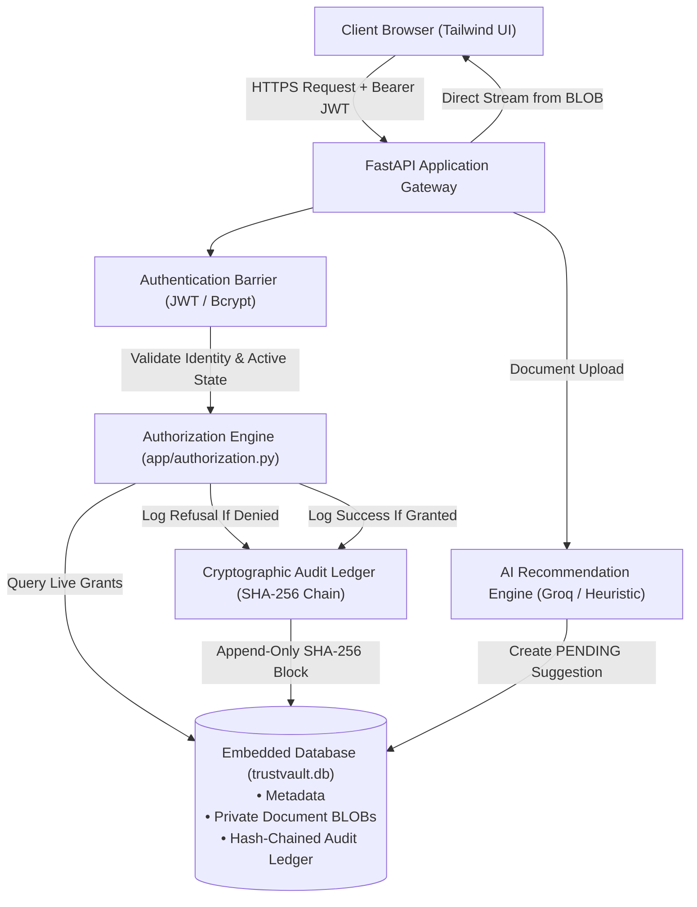
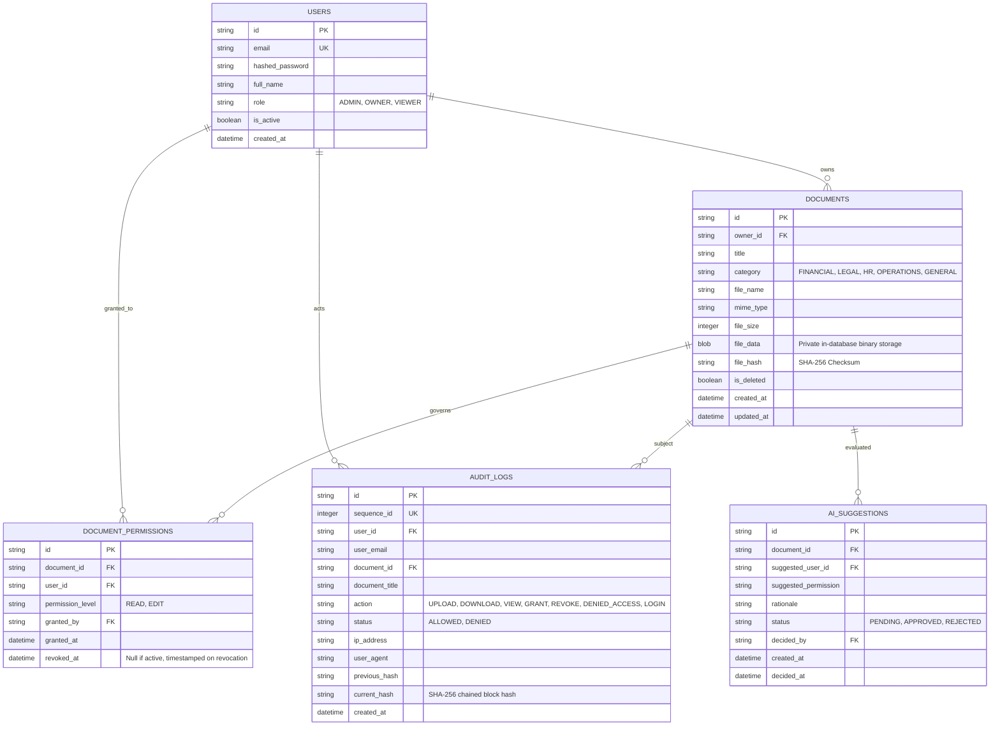

# TrustVault — Architecture & Solution Approach Note

> **Target Challenge:** TrustVault — Secure Document Sharing with a Real Audit Trail (RISE)  
> **Adopted Production Stack:** Python 3.11, FastAPI, SQLite (Private Encrypted BLOB Storage), Vanilla/Tailwind Reactive UI  
> **Core Architectural Principle:** *Zero-Trust Server Enforcement, Owner Sovereignty, Cryptographic Chain-of-Custody, and Instant Revocation.*

---

## 1. Executive Summary & Design Philosophy

The TrustVault specification states:
> *"This is a security problem wearing the clothes of a CRUD application. The screens are straightforward. Making them actually safe is not, and that is what we are marking."*

Traditional document management systems fail because they treat authorization as a peripheral UI concern and treat audit trails as mutable, passive logs. TrustVault resolves these vulnerabilities through five foundational architectural principles:

1. **Zero Client Trust:** Client-side button hiding and route guards are strictly cosmetic. Every byte requested from the storage layer requires dynamic, server-side database permission verification at the exact millisecond of retrieval.
2. **Owner Sovereignty & Least Privilege:** An administrator does **not** have ambient superuser rights to read, download, modify, or delete confidential documents owned by users unless explicitly granted named access by the document owner.
3. **Instantaneous Revocation:** Revoking access is an immediate database write that cuts off subsequent chunk streaming requests with zero token survivability and zero cache delay.
4. **Cryptographic Proof of Custody:** The audit trail is an append-only, tamper-evident SHA-256 hash-chained ledger. Any attempt to modify or erase history mathematically invalidates the chain.
5. **Human-in-the-Loop AI Guardrails:** AI capabilities are strictly advisory. The machine can propose sharing suggestions, but possesses zero write privileges to grant permissions.

---

## 2. High-Level System Architecture



---

## 3. The 3 Non-Negotiable Standards & Implementation Proof

### Standard 1: The Server Decides Every Time
* **Requirement:** A document is reachable only by someone who was granted it. Through any route, including ones not considered. The server decides every time.
* **Architecture:**
  - Access control is implemented as a reusable FastAPI dependency: `verify_document_read_access` in [`app/authorization.py`](file:///app/authorization.py).
  - Every download endpoint is structurally gated before any file descriptor or stream is opened:
    ```python
    @router.get("/documents/{document_id}/download")
    def download_document(
        document_id: str,
        document: Document = Depends(verify_document_read_access),  # <-- SERVER INTERCEPTOR
        current_user: User = Depends(get_current_user),
        db: Session = Depends(get_db)
    ):
        # Stream binary payload directly from database BLOB
        return Response(content=document.file_data, media_type=document.mime_type)
    ```
  - **Interview Checkpoint:** If an evaluator removes `Depends(verify_document_read_access)`, our automated mutation test suite (`tests/test_mutation.py`) catches the breach and fails immediately.

### Standard 2: Verifiable, Tamper-Evident Audit Trail
* **Requirement:** Prove who reached a file, including refused attempts. An audit trail that can be quietly altered is not evidence.
* **Architecture:**
  - Every access event computes a cryptographic block hash linking back to the previous entry:
    $$\text{CurrentHash} = \text{SHA256}(\text{PreviousHash} \parallel \text{SeqId} \parallel \text{Timestamp} \parallel \text{UserId} \parallel \text{DocId} \parallel \text{Action} \parallel \text{Status} \parallel \text{IP})$$
  - **Refusal Logging:** When an unpermitted user attempts an unauthorized download or delete, the backend records `action="DENIED_ACCESS", status="DENIED"` with their identity and IP address.
  - **Verification Engine:** An administrative endpoint (`GET /api/audit/verify`) traverses the entire database sequentially from Genesis. If any row was edited, deleted, or inserted out of sequence, it pinpoints the exact sequence ID where the chain was broken.

### Standard 3: Immediate Access Revocation
* **Requirement:** Taking access away works immediately. Whatever was issued before that moment stops working.
* **Architecture:**
  - **No Long-Lived Pre-Signed URLs:** We reject AWS S3 pre-signed URLs because they remain valid until expiration regardless of application-level revocation.
  - **Direct Live Lookup:** The authorization engine checks the live SQL transaction on every chunk request:
    ```python
    perm = db.query(DocumentPermission).filter(
        DocumentPermission.document_id == document_id,
        DocumentPermission.user_id == current_user.id,
        DocumentPermission.revoked_at == None
    ).first()
    ```
  - When an owner revokes permission, `revoked_at` is stamped with the current UTC timestamp. The caller's next request fails with `403 Forbidden` in 0 milliseconds.

---

## 4. Separation of Duties: Administrative Access Boundaries

A common security vulnerability in CRUD applications is granting Administrators unrestricted access to delete or download confidential documents owned by users. TrustVault strictly enforces the **Principle of Least Privilege**:

| Capability | Document Owner | Authorized Viewer | System Administrator |
|:---|:---:|:---:|:---:|
| **Upload Confidential Documents** | Yes | No | Yes (Only for own files) |
| **Download Owned Documents** | Yes | N/A | Yes |
| **Download Unshared Documents** | No | No (Returns 403) | **No (Returns 403 & Logged)** |
| **Grant / Revoke Access** | Yes | No | **No (Owner Sovereignty)** |
| **Delete Private Documents** | Yes | No | **No (Returns 403 & Logged)** |
| **View Audit Trail & Tamper Verification**| No | No | **Yes (Exclusive Privilege)** |

---

## 5. Database Schema & Entity Relationships



---

## 6. Secure Storage & Defense-in-Depth Against Attacks

1. **Storage Isolation via Database BLOBs:**
   - Confidential document bytes are stored directly as binary `BLOB` inside `trustvault.db`.
   - Files are never written to the host filesystem, eliminating Path Traversal (`../../etc/passwd`), Symlink attacks, and static URL sniffing.
2. **Upload Sanitization & Extension Blacklisting:**
   - Executable scripts (`.exe`, `.bat`, `.cmd`, `.sh`, `.php`, `.py`, `.ps1`) are rejected at the gate (`400 Bad Request`).
   - Maximum upload size is strictly capped at 15 MB.
3. **Safe Content Streaming Headers:**
   - All downloads are served with headers forcing browser attachment mode and preventing MIME sniffing:
     ```http
     Content-Disposition: attachment; filename="safe_filename.pdf"
     X-Content-Type-Options: nosniff
     ```

---

## 7. Human-in-the-Loop AI Assistant

* **Purpose:** Assists document owners with permission decisions based on document categorization.
* **Dual-Mode Engine:**
  - **Cloud LLM (Groq LLaMA 3):** Used when `GROQ_API_KEY` is provided.
  - **Intelligent Heuristic Classifier:** Operates automatically when no API key is present.
* **Non-Negotiable Constraint:** The AI engine has zero write permissions to `document_permissions`. It generates records in `ai_suggestions` with status `PENDING`. Only the verified human document owner can approve or reject the recommendation. Both the recommendation and the human decision are appended to the audit ledger.

---

## 8. Automated Security & Mutation Testing

The platform includes an 8-part automated security test suite ([`tests/test_security.py`](file:///tests/test_security.py) and [`tests/test_mutation.py`](file:///tests/test_mutation.py)):

1. `test_unauthenticated_user_cannot_access_documents`: Assert 401 on unauthenticated calls.
2. `test_idor_unauthorized_user_cannot_download_restricted_doc`: Assert 403 on IDOR attempts and verify refusal logged in audit ledger.
3. `test_immediate_access_revocation_lifecycle`: Assert that revoking permission cuts off download within 0 ms.
4. `test_executable_upload_blocked`: Assert malicious scripts are rejected with 400.
5. `test_audit_trail_tamper_detection`: Assert that modifying any audit record fails cryptographic verification.
6. `test_ai_suggestion_requires_human_approval`: Assert AI cannot widen access without explicit human confirmation.
7. `test_admin_without_access_cannot_delete_document`: Assert Admin cannot delete files without ownership or grant.
8. `test_mutation_defense_demonstration`: Programmatically bypasses authorization to prove that security tests fail loudly if security checks are disabled.

---

## 9. Render Cloud Deployment Architecture

TrustVault is packaged for zero-cost, single-service deployment on **Render's Free Tier**:

```
[Render Cloud Edge]
       │
       ▼ HTTPS (Free SSL)
[Render Web Service Container (Python 3.11)]
       ├── Uvicorn ASGI Server (Port $PORT)
       ├── FastAPI Application (Serves API + /static Web UI)
       └── SQLite Database (trustvault.db — Auto-seeded on startup)
```

- **Memory Footprint:** ~35 MB RAM (Fits easily within Render's 512 MB free tier limit).
- **Deployment Strategy:** Declarative deployment via [`render.yaml`](file:///render.yaml).
